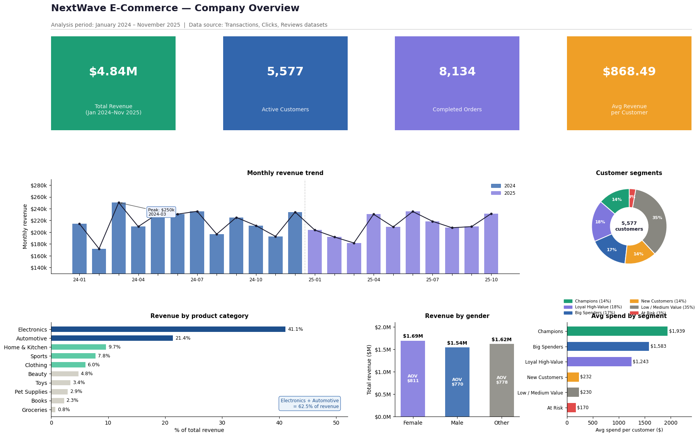
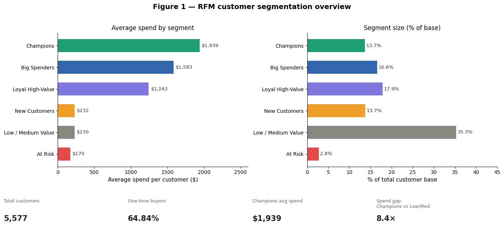
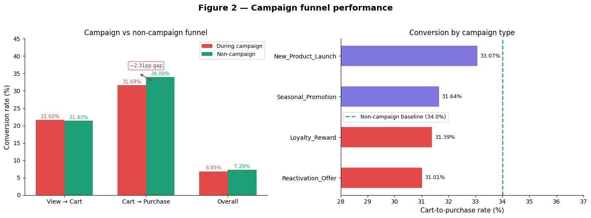
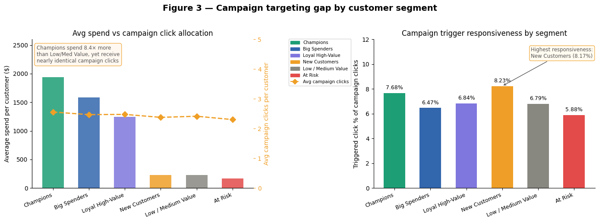
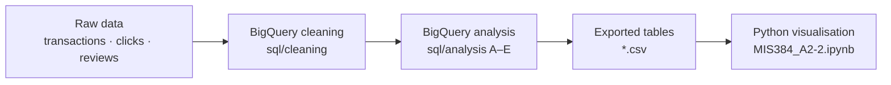

<div align="center">

# NextWave: Customer Segmentation & Campaign Funnel Analysis

**Why were marketing campaigns hurting conversion instead of helping it?**

[](sql)
[](MIS384_A2-2.ipynb)
[](https://colab.research.google.com/github/ashlynn-05/NextWave/blob/main/MIS384_A2-2.ipynb)

[Key findings](#key-findings) • [Recommendations](#recommendations) • [Approach](#approach) • [Repository structure](#repository-structure) • [Reproduce it](#reproduce-the-analysis)

</div>

RFM segmentation and campaign funnel analysis for NextWave, an e-commerce retailer, built with **BigQuery SQL** and **Python**. The analysis covers transaction, click and review data and shows that NextWave's campaigns were attracting attention rather than driving purchases, and that campaign spend was not targeted by customer value at all.



| Revenue | Customers | Orders | Window |
| :-: | :-: | :-: | :-: |
| **$4.84M** | **5,577** | **8,134** | **23 months** (Jan 2024 – Nov 2025) |

> [!NOTE]
> This was an academic project for MIS384 at Deakin University. NextWave and its datasets were provided for the assignment.

## Key findings

### 1. Revenue depends on acquisition, not retention

**64.84% of customers bought only once**, and no customer placed more than six orders. Even the best customers are drifting away: **Champions** (13.7% of the base) average **$1,938.87** in spend but have not purchased for **268 days** on average.



### 2. Campaigns lower conversion

Cart-to-purchase conversion **falls from 34.0% outside campaigns to 31.69% during them**, a 2.31 percentage-point drop. Only **7.09%** of campaign-period clicks (1,732 of 24,434) were triggered by a campaign. The rest was ordinary browsing that got counted as campaign success.



### 3. Campaign spend ignores customer value

Champions spend **8.4×** as much as Low / Medium Value customers ($1,938.87 vs $230.04) but receive almost the same campaign exposure (2.56 vs 2.42 average campaign clicks). **New Customers** respond best to campaigns (**8.23%** triggered-click rate) even though they spend the least.



> [!IMPORTANT]
> **Key insight:** campaigns are measured by clicks, not by revenue impact. That metric hides two problems: campaigns are buying attention rather than purchases, and the budget is spread evenly across customers of very different value.

## Recommendations

| # | Recommendation | Evidence |
| :-: | --- | --- |
| 1 | **Prioritise Champions and Loyal High-Value customers** in New Product Launch campaigns | Best-performing campaign type at 33.07% cart-to-purchase |
| 2 | **Build a 90-day onboarding sequence** for New Customers | Most responsive segment (8.23%) but the least retained |
| 3 | **Suspend Reactivation Offer campaigns** and redirect budget to cart-abandonment recovery | Worst performer at 31.01% cart-to-purchase; At Risk customers are the least responsive |
| 4 | **Measure campaigns by revenue per converting customer**, not click volume | 92.91% of campaign-period clicks were not triggered by the campaign |

## Approach



The analysis in [`sql/analysis`](sql/analysis) runs in five sections, each building on the one before:

| Section | Focus | Highlights |
| --- | --- | --- |
| **A**: [Data scope](sql/analysis/a_data_scope.sql) | Record counts, date range, analysis window | Confirms the cleaned data matches the 23-month scope |
| **B**: [RFM segmentation](sql/analysis/b_rfm_segmentation.sql) | Customer-level table, `NTILE(5)` R/F/M scoring, six segments | Segment labels come from a priority-ordered `CASE` so no customer lands in two segments |
| **C**: [Campaign effectiveness](sql/analysis/c_campaign_effectiveness.sql) | View → cart → purchase funnel, campaign vs non-campaign, by type and by campaign | Non-campaign periods serve as the baseline for comparison |
| **D**: [Product & satisfaction](sql/analysis/d_product_satisfaction.sql) | Category revenue, top brands, co-purchases, ratings by segment | Electronics and Automotive make up about 62.5% of revenue |
| **E**: [Segment × campaign](sql/analysis/e_segment_campaign_crossover.sql) | Campaign engagement and responsiveness by RFM segment | Measures the targeting gap behind recommendations 1–3 |

<details>
<summary><strong>RFM segment definitions</strong></summary>

Each customer gets a 1–5 quintile score for Recency, Frequency and Monetary value. Segments are assigned in this order, and the first match wins:

| Segment | Rule | Share of base | Avg spend |
| --- | --- | :-: | :-: |
| Champions | R ≥ 4, F ≥ 4, M ≥ 4 | 13.7% | $1,938.87 |
| Loyal High-Value | F ≥ 4, M ≥ 3 | 17.9% | $1,243.40 |
| Big Spenders | M ≥ 4 | 16.6% | $1,582.63 |
| At Risk | R ≤ 2 and (F ≥ 4 or M ≥ 4) | 2.8% | $169.98 |
| New Customers | R ≥ 4, one order | 13.7% | $232.12 |
| Low / Medium Value | Everyone else | 35.3% | $230.04 |

Only orders with a `completed` or `shipped` status count. Monetary value is `SUM(item_total)` per customer.

</details>

<details>
<summary><strong>Data cleaning</strong></summary>

The [`sql/cleaning`](sql/cleaning) scripts check each raw dataset for nulls, duplicates, invalid values and inconsistent labels, then write a cleaned table:

- **Transactions**: standardised `order_status` labels, recalculated `item_total = quantity × item_price`, and split `order_date` into separate date and time fields
- **Clicks**: removed duplicate `click_id`s, filtered out blank or invalid records, and cleaned the campaign flags and IDs
- **Reviews**: kept only the latest review per user, order and product (6 duplicates removed)

</details>

## Repository structure

```text
.
├── MIS384_A2-2.ipynb          # Main visualisation notebook (all figures)
├── MIS384_A2.ipynb            # Earlier version (Figures 1–5 only)
├── sql/
│   ├── cleaning/              # BigQuery cleaning: transactions, clicks, reviews
│   └── analysis/              # BigQuery analysis: sections A–E
├── images/                    # Charts exported from the notebook
├── transactions_cleaned.csv   # Cleaned order line items (43.5k rows)
├── cleaned_clicks.csv         # Cleaned clickstream with campaign flags (80k rows)
├── reviews_cleaned.csv        # Cleaned product reviews (15k rows)
├── customer_level.csv         # One row per customer: frequency, spend, recency, clicks
├── rfm_segments.csv           # customer_level + R/F/M scores and segment
├── funnel_table.csv           # Funnel counts and rates by campaign status and type
└── campaign_table.csv         # Funnel and triggered-click metrics per campaign
```

## Reproduce the analysis

**Charts only.** Open [`MIS384_A2-2.ipynb`](https://colab.research.google.com/github/ashlynn-05/NextWave/blob/main/MIS384_A2-2.ipynb) in Google Colab. Upload `rfm_segments.csv`, `funnel_table.csv`, `campaign_table.csv` and `customer_level.csv` from the Files panel, then run all cells. Each figure is saved as a PNG.

To run it locally instead:

```bash
git clone https://github.com/ashlynn-05/NextWave.git
cd NextWave
pip install pandas numpy matplotlib seaborn jupyter
jupyter notebook MIS384_A2-2.ipynb
```

> [!TIP]
> The final cell uses `google.colab.files.download()`. Skip it when you run locally, since the figures are already saved to the working directory.

**The full pipeline.** Load the three cleaned CSVs into a BigQuery dataset. Then run the scripts in [`sql/analysis`](sql/analysis) in order, A to E. Sections B and C create the `customer_level`, `rfm_segments`, `funnel_table` and `campaign_table` tables that later sections depend on.

> [!WARNING]
> Table references in the SQL point at the original assignment projects (for example, `leafy-clone-489205-d4.MIS384_A2_CleanedData`). Replace them with your own `project.dataset` before running. `recency_days` is calculated against `CURRENT_DATE()`, so recency values will be higher than the published figures if you rerun today.

## Limitations and next steps

The campaign findings are **correlational**. The analysis shows that conversion is lower during campaign periods, but not whether the campaigns caused the drop or simply brought in lower-intent traffic by design. A next iteration would try to isolate causality, using holdout groups or a difference-in-differences comparison across matched customer cohorts.

The biggest lesson from the project was that **"campaign clicks" was a misleading metric**: it looked like engagement but was mostly noise.
